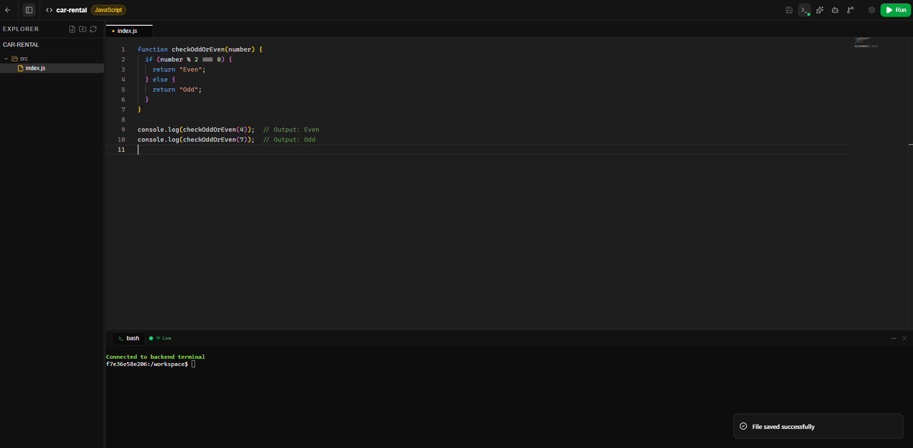
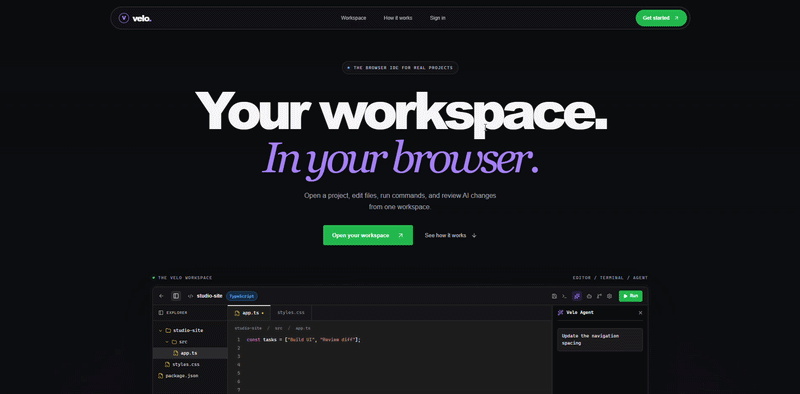
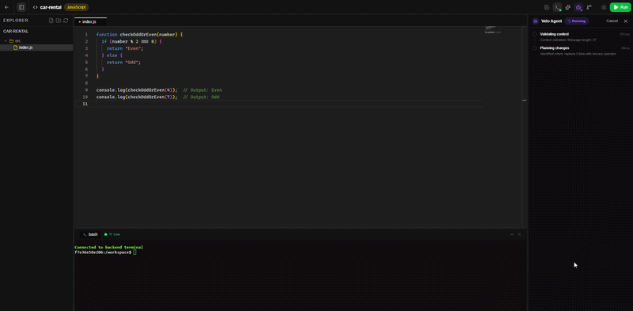
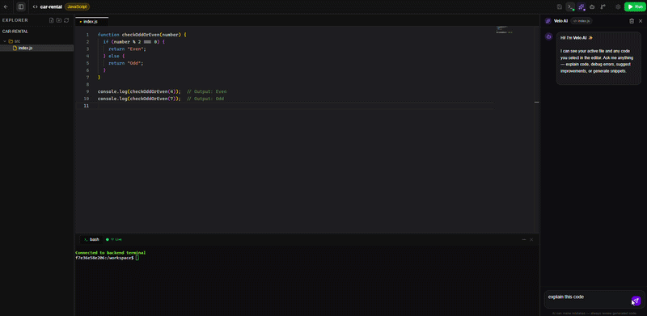
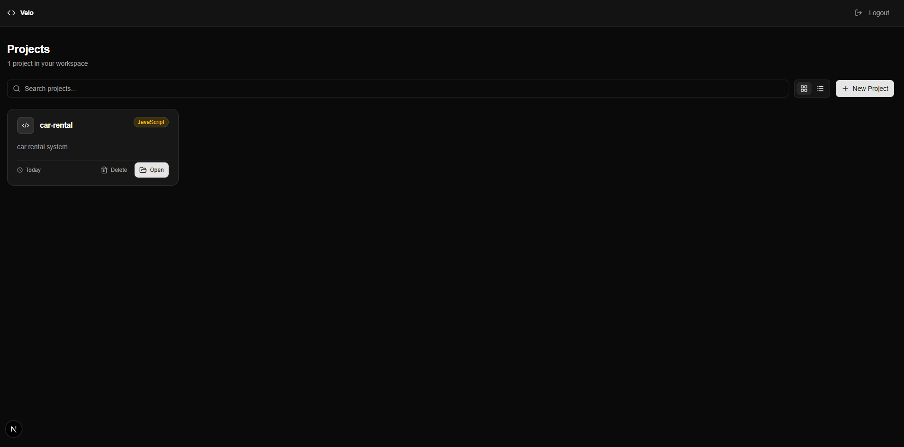
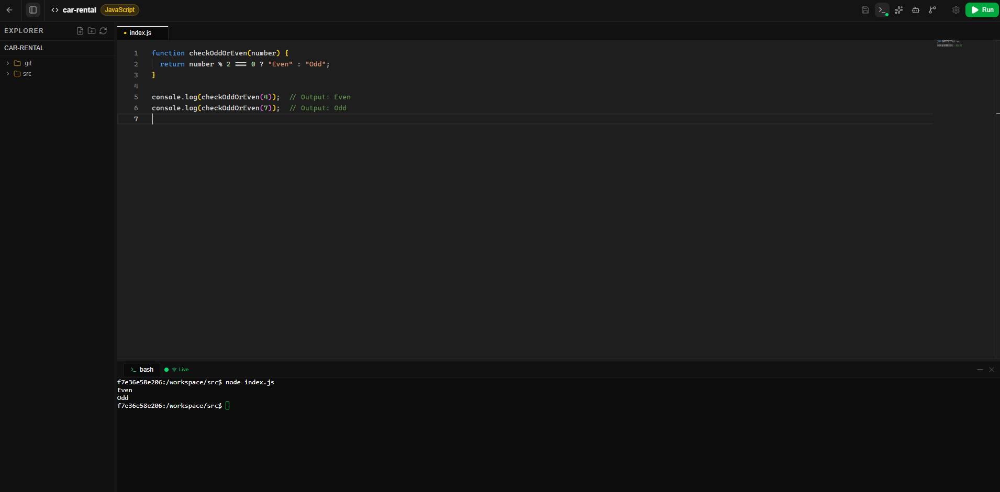
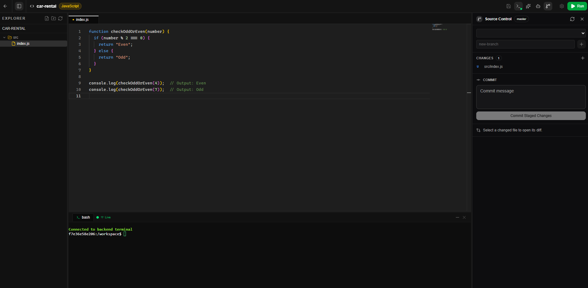
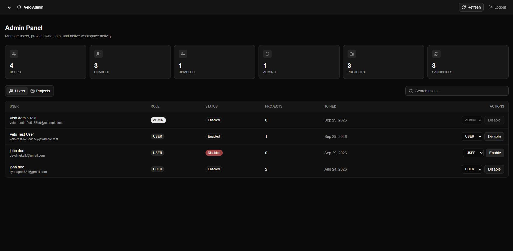
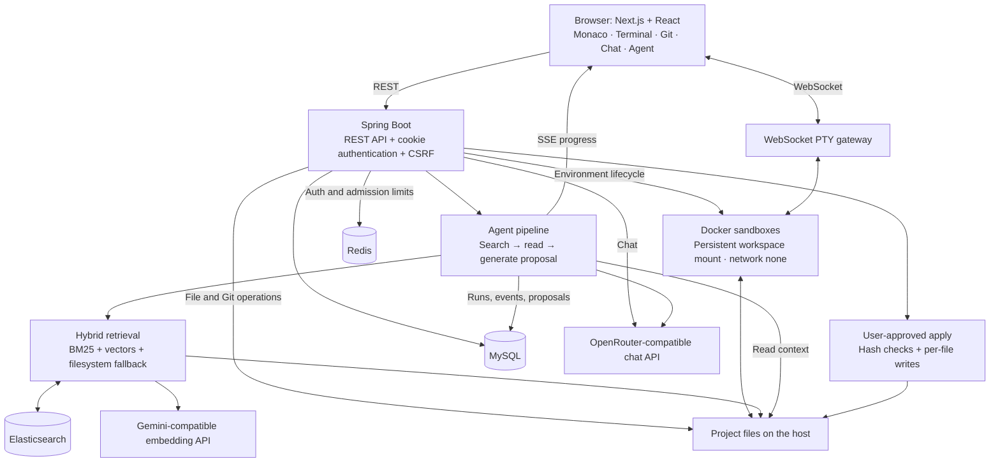

<div align="center">

# ⚡ Velo

**A browser IDE with AI chat, reviewable agent edits, and Docker workspaces.**

[](https://nextjs.org/)
[](https://react.dev/)
[](https://spring.io/projects/spring-boot)
[](https://openjdk.org/)
[](https://www.docker.com/)
[](https://tailwindcss.com/)

[Overview](#overview) · [Demos](#demos) · [Features](#features) · [Architecture](#architecture) · [Getting Started](#getting-started) · [Configuration](#configuration) · [Documentation](#documentation)



</div>

## Overview

Velo brings project management, code editing, a Linux terminal, local Git, and AI assistance into one browser workspace. A Next.js frontend connects to a Spring Boot backend that manages project files, authentication, Docker sandboxes, and AI requests.

**Chat Mode** explains code using the active file and selected text. **Agent Mode** searches the project and generates proposed edits for you to review. You accept or reject individual diff hunks before applying changes to disk.

The application includes a project dashboard, a Monaco editor, an xterm.js terminal, a source control panel, and an admin dashboard. The server provides the runtime; users access the IDE through their browser.

## Demos

### Landing page



### AI agent: review and apply changes

Ask for a code change, follow the agent's progress, and review the proposed diff before applying accepted hunks.



### AI chat: explain code in context

Ask questions about the open file or selected code without changing project files.



### Screenshots

Expand a section to view its screenshot at full width. The editor and terminal layout is shown in the main preview above.

<details>
<summary><strong>Project dashboard</strong> — browse, search, create, and open projects</summary>



</details>

<details>
<summary><strong>Console output</strong> — run code in the workspace terminal</summary>



</details>

<details>
<summary><strong>Version control</strong> — inspect changes, manage branches, and commit</summary>



</details>

<details>
<summary><strong>Admin panel</strong> — view activity and manage users and projects</summary>



</details>

## Features

| Area | Capabilities |
| --- | --- |
| **Projects and files** | Project dashboard, lazy file browsing, file and folder creation, renaming, deletion, and disk-backed saving. |
| **Editor** | Monaco syntax highlighting, multiple tabs, dirty-file tracking, Git diff views, and selection context for AI. |
| **Terminal** | Interactive Linux PTY sessions over WebSocket, ANSI output, and terminal resizing through xterm.js. |
| **Local Git** | Initialize repositories, view status and diffs, stage and unstage files, commit, browse history, and create or switch branches through JGit. |
| **AI chat** | Context-aware explanations and suggestions using the active file, selection, and conversation history. |
| **AI agent** | Background code search and file reading, structured proposals, hunk-level decisions, conflict checks, and user-triggered apply. |
| **Code retrieval** | Elasticsearch BM25 plus Gemini-compatible vector embeddings, combined with reciprocal rank fusion; lexical and filesystem fallbacks. |
| **Accounts and admin** | Email verification, sign-in, password reset, refresh-token rotation, and role-protected user/project administration. |
| **Docker workspaces** | Per-project containers with persistent workspace mounts, CPU/memory/PID limits, non-root execution, and disabled external networking. |

### Current limits

- Agent runs generate proposals; the model has no direct file-write or shell-execution capability. Automated post-apply verification is planned.
- Git integration supports local operations. Remote clone, fetch, pull, and push are not implemented in the IDE.
- The current sandbox image is `node:18-alpine`. Editor language support does not imply that every language runtime is installed.
- Sandboxes use Docker network mode `none`, so terminal commands cannot download packages or reach external services. AI requests originate from the backend.
- Safe apply checks file hashes and stages file replacements. Results are reported per file; a multi-file apply can partially succeed, and atomic replacement depends on filesystem support.

## Architecture

| Layer | Technologies |
| --- | --- |
| Frontend | Next.js 16.1.6, React 19.2.3, TypeScript, Tailwind CSS 4, Monaco, xterm.js, Zustand, Axios |
| Backend | Java 21, Spring Boot 4.0.3, Spring Security, Spring Data JPA, Spring AI, JGit, Maven |
| Runtime and storage | Docker Engine, MySQL, Redis, Elasticsearch |
| AI providers | OpenRouter-compatible chat API and Gemini-compatible embeddings |



### Agent workflow

```text
QUEUED → RUNNING → WAITING_FOR_APPROVAL → APPLYING → DONE
                         │
                         └── Reject run → REJECTED
```

During `RUNNING`, the backend retrieves relevant code, reads context files, requests a structured model response, and stores a diff proposal. SSE delivers progress and supports bounded event replay on reconnect. Every hunk must be accepted or rejected before apply.

Apply checks current disk content against the proposal's base hashes and reports file-level results. Inspect those results even when a run reaches `DONE`. Failure and cancellation paths are also supported. `VERIFYING` exists in the schema, but verification commands are not executed yet.

## Getting Started

### Prerequisites

- **Node.js 20.9 or later** for the frontend, plus **pnpm**. The frontend includes `pnpm-lock.yaml`.
- **JDK 21**. The backend includes the Maven wrapper.
- **Docker Desktop or Docker Engine** with Linux containers enabled.
- **MySQL 8+** and **Redis 7+**, running and reachable by the backend.
- **Elasticsearch 8.x** for indexed search. Search falls back when it is unavailable.
- An **OpenRouter-compatible API key** for Chat and Agent Mode.
- A **Gemini-compatible embedding key** for semantic search, or embeddings disabled in configuration.
- **SMTP configuration** for registration verification and password-reset emails.

### 1. Get the source

The backend and frontend are maintained in separate repositories. To recreate the application directory layout in a new folder:

```sh
mkdir velo
cd velo
git clone https://github.com/dinukaly/Velo-Backend.git backend/velo
git clone https://github.com/dinukaly/velo-frontend.git velo-frontend
```

If you already have this workspace, use its existing directories and skip cloning.

### 2. Prepare the services and sandbox image

Start MySQL, Redis, and Docker. Start Elasticsearch if you want indexed search. The default endpoints are MySQL on `localhost:3306`, Redis on `localhost:6379`, and Elasticsearch on `http://localhost:9200`.

Pull the image used by the current sandbox implementation on the Docker host:

```sh
docker pull node:18-alpine
```

Choose a host directory for `workspace.root`. It must be writable by the backend and accessible to Docker bind mounts. On Linux, project directories must also be writable by the sandbox's UID `1000`.

### 3. Configure and start the backend

From `backend/velo`, copy the [configuration template](backend/velo/src/main/resources/application.properties.example) to `src/main/resources/application-local.properties`.

**PowerShell:**

```powershell
Copy-Item src/main/resources/application.properties.example src/main/resources/application-local.properties
```

**Linux / macOS:**

```sh
cp src/main/resources/application.properties.example src/main/resources/application-local.properties
```

Edit the copied file with your MySQL credentials, JWT signing secret, OpenRouter key, SMTP settings, and embedding key. Set `velo.ai.embedding.enabled=false` if you are not configuring embeddings. The template defaults to Gmail SMTP; adjust its host, port, authentication, and TLS settings for your mail server.

Generate a JWT secret with at least 32 random bytes. For example, this command prints a Base64-encoded random value to paste into `jwt.secret`:

```sh
node -e "console.log(require('node:crypto').randomBytes(32).toString('base64'))"
```

The default workspace root and Docker connection target Windows. Adjust these properties for your host:

| Host | `workspace.root` example | `docker.host` |
| --- | --- | --- |
| Windows / Docker Desktop | `C:/workspace` | `npipe:////./pipe/docker_engine` |
| Linux / macOS | `/absolute/path/to/velo-workspaces` | `unix:///var/run/docker.sock` (or your Docker socket path) |

Start the backend with the **local profile explicitly enabled** so Spring loads `application-local.properties`:

**PowerShell:**

```powershell
.\mvnw.cmd spring-boot:run "-Dspring-boot.run.profiles=local"
```

**Linux / macOS:**

```sh
./mvnw spring-boot:run -Dspring-boot.run.profiles=local
```

The API runs at `http://localhost:8080/api`. Hibernate updates the MySQL schema at startup. The default JDBC URL can create the `velo` database if the configured user has permission; otherwise, create it first.

Keep populated local configuration files out of version control. For deployments, use environment variables or managed secrets and leave the `local` profile disabled.

### 4. Configure and start the frontend

In another terminal, open `velo-frontend` and copy `.env.example` to `.env.local`:

**PowerShell:**

```powershell
Copy-Item .env.example .env.local
```

**Linux / macOS:**

```sh
cp .env.example .env.local
```

The default API URL is `NEXT_PUBLIC_API_URL=http://localhost:8080/api`.

```sh
pnpm install --frozen-lockfile
pnpm dev
```

Open [http://localhost:3000](http://localhost:3000), register and verify your email, then create a project. Open the workspace to edit files, use the terminal, or try Chat and Agent Mode. Save pending editor changes before starting an agent run.

## Configuration

The [backend template](backend/velo/src/main/resources/application.properties.example) lists the full configuration. Environment variable names below are wired into the base properties; explicit values in `application-local.properties` can replace those placeholders for local development.

| Environment variable | Backend property | Purpose / default |
| --- | --- | --- |
| `DB_URL` | `spring.datasource.url` | MySQL JDBC URL; defaults to local database `velo` with `createDatabaseIfNotExist=true`. |
| `DB_USERNAME` / `DB_PASSWORD` | `spring.datasource.username` / `spring.datasource.password` | Database credentials; username defaults to `root`, password has no usable default. |
| `JWT_SECRET` | `jwt.secret` | Random signing secret, at least 32 UTF-8 bytes; required in every profile. |
| `REDIS_HOST` / `REDIS_PORT` | `spring.data.redis.host` / `spring.data.redis.port` | Defaults to `localhost:6379`; used for authentication and request admission. |
| `WORKSPACE_ROOT` | `workspace.root` | Host project directory; defaults to `C:/workspace`. |
| `DOCKER_HOST` | `docker.host` | Docker connection URI; defaults to the Windows named pipe. |
| `OPENROUTER_API_KEY` | `spring.ai.openai.api-key` | Chat and Agent provider key. |
| `OPENROUTER_BASE_URL` | `spring.ai.openai.base-url` | Defaults to `https://openrouter.ai/api`. |
| `EMBEDDING_ENABLED` | `velo.ai.embedding.enabled` | Defaults to `true`; disable to omit semantic embeddings. |
| `EMBEDDING_API_KEY` | `velo.ai.embedding.api-key` | Embedding provider key. |
| `EMBEDDING_MODEL` | `velo.ai.embedding.model` | Configured default: `text-embedding-004`; provider/model availability must match your setup. |
| `ELASTICSEARCH_URI` | `spring.elasticsearch.uris` | Defaults to `http://localhost:9200`. |
| `MAIL_HOST` / `MAIL_PORT` | `spring.mail.host` / `spring.mail.port` | SMTP endpoint; defaults to `smtp.gmail.com:587`. |
| `MAIL_USERNAME` / `MAIL_PASSWORD` | `spring.mail.username` / `spring.mail.password` | SMTP credentials for account email flows. |
| `APP_BASE_URL` / `APP_FRONTEND_URL` | `app.base-url` / `app.frontend-url` | Email links and redirects; defaults to ports `8080` / `3000` on localhost. |
| `CORS_ALLOWED_ORIGINS` | `cors.allowed-origins` | Exact browser-origin allowlist; defaults to `http://localhost:3000`. |
| `COOKIE_SECURE` / `COOKIE_SAMESITE` | `cookie.secure` / `cookie.same-site` | Local defaults: `false` / `Lax`. Use Secure cookies with HTTPS; `None` requires Secure. |

The frontend reads `NEXT_PUBLIC_API_URL` from `velo-frontend/.env.local`. Keep the `/api` suffix: service clients append versioned paths such as `/v1/auth` and `/v2/files`.

Normal backend startup validates database, chat, authenticated-SMTP, and enabled-embedding credentials. The sole active `local` profile relaxes some provider credential checks, but it still requires a valid JWT secret and working services for the features you use.

## Development

Run commands from the corresponding project directory.

| Project | Command | Purpose |
| --- | --- | --- |
| Backend (PowerShell) | `.\mvnw.cmd test` | Run the backend tests. |
| Backend (Linux / macOS) | `./mvnw test` | Run the backend tests. |
| Frontend | `pnpm exec tsc --noEmit` | Check TypeScript types. |
| Frontend | `pnpm build` | Create the production build. |
| Frontend | `pnpm start` | Serve the production build. |

The frontend currently defines no dedicated test or lint script.

## Project Structure

```text
velo/
├── README.md                         # Workspace overview and media gallery
├── media/                            # GIF demos and screenshots
├── backend/
│   └── velo/                         # Backend Git repository
│       ├── pom.xml                   # Maven dependencies and build
│       ├── mvnw / mvnw.cmd           # Maven wrapper
│       └── src/
│           ├── main/
│           │   ├── java/com/dinukaly/velo/
│           │   │   ├── config/       # Security, Docker, AI, and runtime configuration
│           │   │   ├── controller/   # REST and SSE endpoints
│           │   │   ├── service/      # Interfaces and implementations
│           │   │   ├── entity/       # JPA entities and search documents
│           │   │   ├── repo/         # Persistence repositories
│           │   │   ├── terminal/     # WebSocket PTY sessions
│           │   │   └── util/         # Paths, prompts, policies, and helpers
│           │   └── resources/        # Base configuration and local template
│           └── test/                 # Backend tests
└── velo-frontend/                    # Frontend Git repository
    ├── app/                          # Landing, auth, dashboard, IDE, and admin routes
    ├── components/ide/               # Editor, terminal, Git, Chat, and Agent panels
    ├── hooks/                        # SSE, terminal, and UI hooks
    ├── services/                     # API clients
    ├── store/                        # Zustand state
    ├── types/                        # Shared TypeScript types
    ├── .env.example                  # Frontend configuration template
    └── pnpm-lock.yaml                # Dependency lockfile
```

## Security and Runtime

Implemented controls include project ownership checks, workspace path validation, HttpOnly authentication cookies, CSRF protection, shared REST/WebSocket origin restrictions, and Redis-backed request limits. AI context uses protected-path filtering and best-effort credential redaction.

Docker sandboxes run as a non-root user with dropped capabilities, a read-only root filesystem, bounded temporary storage, and CPU, memory, and process limits. The project mount remains writable and persistent. These controls still require verification on the deployment host.

Production hardening remains in progress, including workspace disk quotas, broader adversarial testing, and live infrastructure checks.

## Documentation

- [Backend README](backend/velo/README.md) — backend setup and service architecture.
- [Frontend README](velo-frontend/README.md) — frontend setup and UI architecture.

## Contributing

Fork the relevant [backend](https://github.com/dinukaly/Velo-Backend) or [frontend](https://github.com/dinukaly/velo-frontend) repository, create a feature branch, and include the relevant checks from [Development](#development) with your pull request. Update documentation when changing setup, API contracts, or user-visible behavior.

## Acknowledgments

Velo is built with open-source technologies including Next.js, React, Spring Boot, Monaco Editor, xterm.js, and JGit. Thanks to the maintainers and contributors who make these projects possible.
